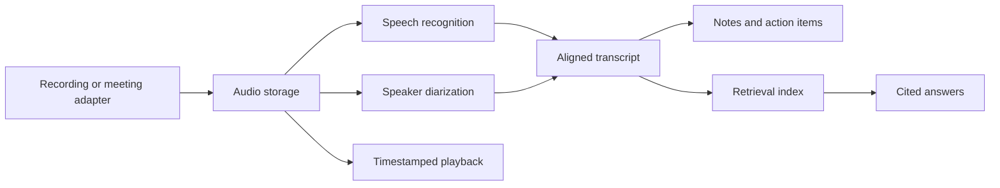
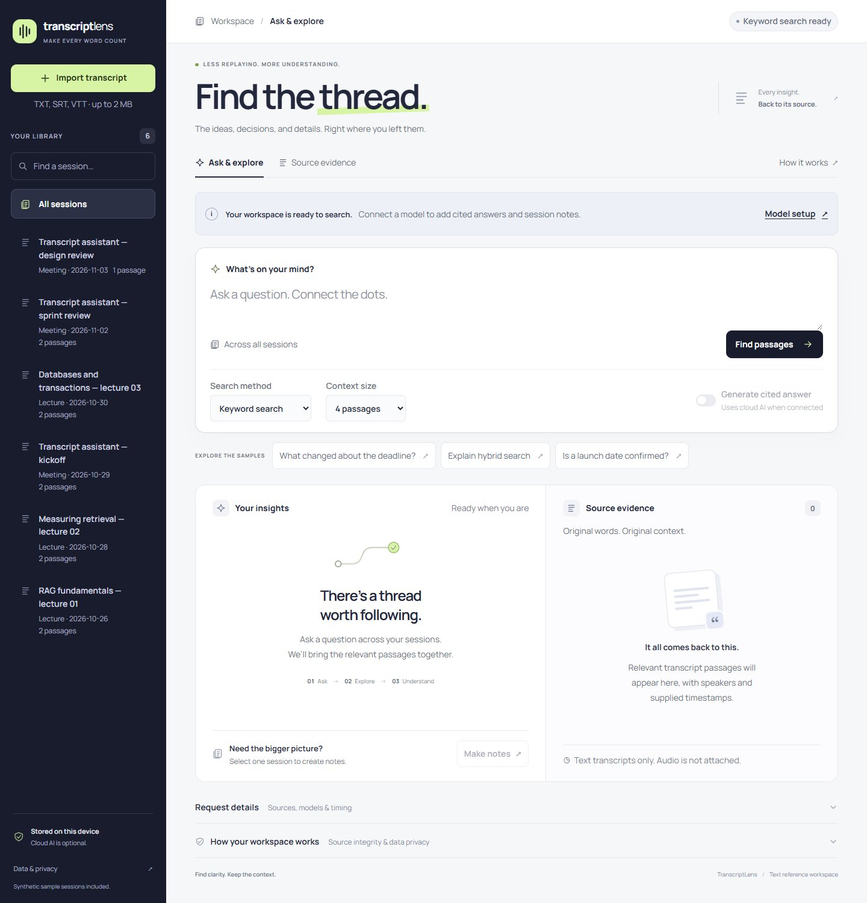

# TranscriptLens

A lecture and meeting assistant for recording conversations, preserving speaker-attributed transcripts, and answering questions with timestamped evidence.

**Project status: text prototype plus a separate capture pilot.** The portal supports text-transcript workflows. A self-hosted Google Meet bot has joined and exported a short approved recording in a separate pilot; speech recognition, speaker diarization and portal audio integration remain upcoming components. Live model-backed retrieval and generation have not yet been verified.

## Project goals

- Preserve meeting recordings and the relationship between audio, speakers, and transcript passages.
- Produce reviewable lecture notes, meeting decisions, and explicit action items.
- Answer questions across sessions using retrieval-augmented generation and source citations.
- Support Windows recording and, in a later phase, a visible Google Meet participant bot.
- Keep capture, transcription, storage, retrieval, and generation independently testable and replaceable.

## Architecture



The [architecture review](docs/ARCHITECTURE_REVIEW.md) records the inspected prototype and gaps. The [architecture document](docs/ARCHITECTURE.md) defines component responsibilities, data flow and failure handling; [contracts](docs/CONTRACTS.md) define revision-safe evidence and publication semantics. The [requirements](docs/REQUIREMENTS.md) distinguish confirmed constraints from open decisions. Implementation will proceed through the component-level [roadmap](docs/BUILD_PLAN.md), starting with durable recording import and recovery after architecture review.

The proposed system processes locally by default, with explicit opt-in for cloud operations. The reference prototype currently offers optional cloud-backed embeddings/generation; local speech/generation runtimes and the full processing-policy boundary are not yet implemented.

The intended meeting workflow is a [local/self-hosted joining bot](docs/MEETING_BOT.md) that produces stable Person A/B transcripts and recordings inside this portal. The linked assessment records the capture-route constraints and first live acceptance gate; those capabilities are not implemented by the current text prototype.

An experimental [capture-only pilot kit](docs/CAPTURE_PILOT.md) and separate [authenticated deployment](docs/AUTHENTICATED_CAPTURE.md) evaluate self-hosted capture before speech processing or portal integration. The dedicated-account bot joined a real approved Meet call, with participant visibility confirmed by its host. A 120.18-second audio file finalized, exported with matching checksums and decoded locally with non-silent samples. Listening quality, local speech and portal integration remain subsequent checks.

## Reference prototype

The current reference implementation uses Python, Django, SQLite, and a browser interface. These describe the existing prototype; the architecture review will determine the implementation choices for subsequent components.

| Capability | Current status |
|---|---|
| UTF-8 TXT, SRT, and VTT ingestion | Implemented and covered by tests |
| Timestamp and speaker metadata preservation | Implemented for supplied transcript text |
| BM25 keyword search | Implemented and evaluated on synthetic examples |
| Semantic search and hybrid rank fusion | Implemented; live embedding verification pending |
| Cited Q&A and selected-session notes | Implemented; live generation verification pending |
| Browser conversation history and progressive response reveal | Implemented; restores questions, sources and drafts after refresh |
| Audio recording and playback | Planned |
| Automatic speech recognition and diarization | Planned |
| Google Meet participant bot | Planned |

For preparing recordings as importable text, see the [transcript workflow](docs/TRANSCRIPT_WORKFLOW.md) and [synthetic TXT template](docs/examples/transcript-template.txt).



## Run the reference prototype

Prerequisites: Python 3.12–3.14 with pip and venv. Python 3.15 support is experimental for the pinned Django release.

```sh
git clone https://github.com/rahulsharma027/meeting-bot.git
cd meeting-bot
python run.py
```

Use `python3` where required. The launcher creates a virtual environment, installs pinned dependencies, initializes SQLite, and loads six synthetic sessions. Open the printed URL, normally `http://127.0.0.1:8010`. Subsequent runs preserve uploaded transcripts and compatible embeddings.

```sh
python run.py --setup-only
python run.py --port 8011
```

The reference server is intended for a single local user. Authentication and shared deployment are outside the current implementation.

## Configure the optional model integration

Copy `.env.example` to `.env` and set `GEMINI_API_KEY` locally. On PowerShell:

```powershell
Copy-Item .env.example .env
```

Restart the application, build the semantic index, and choose a retrieval method. A configured key does not establish successful provider connectivity. Without a key, keyword search remains available and no generated answer is substituted.

Model identifiers are configurable through `GEMINI_GENERATION_MODEL` and `GEMINI_EMBEDDING_MODEL`. The current adapter uses the Gemini `generateContent` and `batchEmbedContents` endpoints. Account access, model compatibility, quotas, and pricing should be checked against the [provider documentation](https://ai.google.dev/gemini-api/docs).

Indexing sends transcript passages to the model provider. Semantic search sends the question; generated answers send the question and selected passages; notes send the selected transcript. Use synthetic or authorized material and review the provider's data terms before processing private conversations.

## Verification

After setup, on Windows:

```powershell
.venv/Scripts/python.exe manage.py check
.venv/Scripts/python.exe -m unittest discover -v
.venv/Scripts/python.exe evaluate.py
```

On macOS/Linux, use `.venv/bin/python`. The recorded baseline has 24 passing tests. Retrieval evaluation uses 12 synthetic development questions with document-level relevance labels; it is not an independent benchmark or a measure of generated-answer accuracy.

See [verification results and limitations](docs/VERIFICATION.md). The current implementation requires separate live validation of embeddings, generated notes, source support, and abstention behaviour.

## Data and limitations

- Inputs: UTF-8 TXT, SRT, and VTT, up to 2 MB and 180,000 decoded characters per file.
- Prototype limits: 100 transcripts and 2,000 chunks; whole-transcript notes support up to 24,000 characters of chunk content.
- Search: exact cosine comparison over stored vectors, BM25 keyword retrieval, and reciprocal rank fusion. No approximate-nearest-neighbour index or learned reranker is implemented.
- Provenance: source IDs and quoted substrings are validated. These checks do not prove that a generated claim, speaker assignment, task owner, or deadline is correct.
- Local files: configuration, recordings, databases, model downloads, and private exports are excluded from version control. Back up the local database while the application is stopped.

## Documentation

- [Requirements](docs/REQUIREMENTS.md)
- [Architecture review and repository evidence](docs/ARCHITECTURE_REVIEW.md)
- [Architecture](docs/ARCHITECTURE.md)
- [Component data and lifecycle contracts](docs/CONTRACTS.md)
- [Frontend direction and stack recommendation](docs/FRONTEND.md)
- [UI audit and refinement results](docs/UI_AUDIT.md)
- [Component roadmap](docs/BUILD_PLAN.md)
- [Reference implementation](docs/PROTOTYPE.md)
- [Verification](docs/VERIFICATION.md)
- [Architecture decision record](docs/decisions/0001-independent-project.md)
- [Proposed local processing and provenance decision](docs/decisions/0002-local-processing-and-provenance.md)
- [AI assistance disclosure](docs/AI_USE.md)
