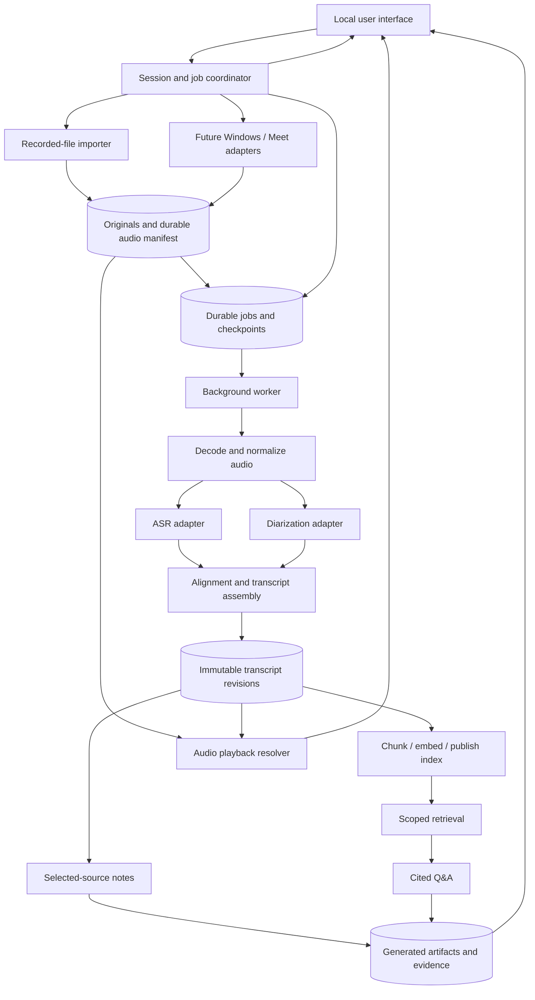

# System architecture

Status: proposed architecture for review, 2026-11-05. This document implements no audio or meeting integration. See [repository review](ARCHITECTURE_REVIEW.md), [data contracts](CONTRACTS.md), [implementation gates](BUILD_PLAN.md), and [proposed ADR 0002](decisions/0002-local-processing-and-provenance.md).

## Requirements, assumptions, and open decisions

Confirmed requirements: authorized recording import, eventual Windows capture, preserved originals, timestamped speaker-attributed transcripts, corrections, cited notes/Q&A, and audio playback. Google Meet is the first intended platform; a visible participant bot is a later component. Speech processing is confirmed local by default with explicit cloud opt-in; this design proposes the same boundary for text processing. The initial use case includes technical meetings and conversations; lecture support remains in scope.

Provisional assumptions: one local user, one active capture session, and recorded-file processing before live inference. Begin with one application codebase, one background worker process, SQLite metadata/jobs, and local audio files. Retain Django and the browser UI as the reference shell while verifying these boundaries. No rewrite is justified yet. A Windows capture helper may be needed later; browser-only capture is not assumed sufficient.

Languages, recording lengths, hardware, speaker counts, quality/latency targets, retention duration, and the Google Meet integration route remain open. Runtime/model selection requires current official documentation, compatibility and licensing/attribution review, and representative tests. No model version, platform API, hardware minimum or pricing is selected here.

## Component map and end-to-end flow

The diagram shows logical dependencies, not mandatory parallel execution. ASR and diarization may run sequentially to fit hardware. Capture writes independently of inference; workers read committed ranges. An optional memory wakeup queue is only a notification mechanism; durable manifests/jobs are authoritative. No broker is needed initially.

1. Create a session and record approval and data-flow choices. Import exact original bytes into managed storage, or later start a visible capture adapter.
2. Commit a durable source manifest before scheduling inference. Decode into rebuildable working audio with explicit original-to-working time maps. Decode failure preserves the original.
3. Run ASR and diarization on consistently mapped audio; validate intervals and align anonymous speakers without inventing names or timing precision.
4. Publish a complete transcript revision transactionally. Future live drafts may reach the UI but never ordinary retrieval or final notes.
5. Build chunks and optional embeddings against pinned source revisions/configuration; publish complete compatible index snapshots.
6. Generate notes from an explicit source selection, or retrieve within an explicit session set for Q&A. Persist claims, evidence and processing provenance; return a result, insufficient-information state or error.
7. Resolve citations through immutable segment revisions to actual audio ranges. Untimed text or unavailable audio has no fabricated playback link.

## Responsibilities and interfaces

These are proposed module operations, not existing HTTP endpoints. Prefer typed records/functions. Adapters isolate actual runtime/platform dependencies; there is no general plugin framework.

| Component | Proposed interface | Responsibility and limit |
|---|---|---|
| Coordinator | `create_session`, `start/pause/resume/stop_capture`, `cancel_job`, `retry_job`, `get_status` | Approval/policy checks, valid transitions, atomic job creation, separate capture/source/transcript/index states |
| File importer | `import_recording(session_id, stream, request_key) -> SourceAsset` | Bounded streaming copy, hash, safe internal filename and durable original; no inference during upload |
| Windows capture | `start(config)`, `pause`, `resume`, `stop -> CaptureManifest` | Device ownership, microphone/meeting tracks, bounded buffers, clock mapping, committed ranges/gaps and visible health |
| Future Meet adapter | Capture contract plus admission/disconnect events | Platform access, visible participant and media delivery; local playback capture does not imply bot participation or participant identity |
| Audio store / decoder | `commit_source`, `open_range`, `inspect/decode -> WorkingAudioRef` | Immutable originals, safe internal paths, recoverable partial sources and derivative time maps |
| ASR adapter | `transcribe(audio_ref, range, config, cancellation) -> ASRResult` | Text, engine-supported intervals, language and partial/final status; no participant identification |
| Diarization adapter | `diarize(audio_ref, range, config, cancellation) -> SpeakerIntervals` | Run-local anonymous labels, overlap and uncertainty; no inferred real names |
| Alignment / transcript repository | `assemble`, `publish_revision`, `apply_correction(expected_revision, edits)` | Time validation, session speaker identities, immutable revisions, split/merge provenance and conflicts |
| Index builder | `build_index(revision_set, config) -> IndexSnapshot` | Final text chunking, exact source spans, compatible embedding cache and atomic publication |
| Retrieval | `search(question, session_ids, snapshot, mode, limit)` | Scope/revision filtering before ranking, bounded passages/context; no implicit scope expansion |
| Notes | `generate_notes(revision_set, selection, config)` | Cited concepts/decisions and explicit actions with declared source coverage; separate from question retrieval |
| Q&A | `answer(question, session_ids, config)` | Scoped retrieval, output/evidence validation and insufficient-information handling; provider failure remains an error |
| Playback / UI | `resolve_audio(citation) -> PlaybackRanges`; status polling | Validate references, map intervals, show revisions/uncertainty and local/cloud flow; no arbitrary filesystem paths |
| Worker / diagnostics | `claim_job`, `heartbeat`, `checkpoint`, `finish_job` | Bounded execution, retries, lease fencing, cancellation and content-free operational metrics |

## Persistence and revisions

SQLite holds metadata, jobs, source manifests, revisions, identities and result provenance; audio lives as files under a managed data directory. Start with a single worker and short database transactions. No model/network operation holds a write transaction. Claims use conditional transactional updates, without assuming broker or database-specific queue features.

Files and DB cannot share one transaction. Imports use a staged manifest, streamed temporary file, hash/size validation, file flush, same-volume atomic rename, then a DB transaction marking availability and creating the next job. Startup reconciliation detects staging leftovers, committed-but-unregistered files, missing files and incomplete manifests. It resumes or quarantines work while preserving recoverable bytes. Filesystem durability and crash behaviour require target-machine tests; do not promise universal power-loss safety.

Preserve accepted imported bytes even if media inspection fails. Configure finite byte/storage/decode-duration/working-space limits and reject before acceptance when limits are known. Future live originals are ordered durable blocks plus a manifest so recovery does not depend on a final container footer. Normalized media, indexes and notes remain derivatives.

Published transcript snapshots are immutable. Corrections compare the expected current revision, record actor/reason/base revision and changed spans, and preserve split/merge predecessor links. ASR reruns create candidate revisions and never overwrite manual corrections. Speaker mapping/name changes are revisioned because they can affect generated claims.

In one transaction, correction publication advances the current pointer, marks affected derived artifacts stale and enqueues rebuilds. Initially rebuild the affected session's full index rather than adding a fine-grained dependency engine. Queries pin revisions/configuration and recheck currentness before returning; changed sources require a stale-result notice or bounded retry. Old citations resolve the retained historical text with a superseded badge. Explicitly deleted evidence is unavailable, never redirected to different text.

## Independent lifecycle states

One global failure flag cannot describe saved audio plus failed ASR. UI status is derived from independent resources:

| Resource | States and interpretation |
|---|---|
| Session | `open -> closed`; either may enter `deleting -> deleted`. Closed sessions remain readable/reprocessable |
| Capture attempt | `idle -> starting -> recording <-> paused -> stopping -> stopped`; errors enter `interrupted` with committed blocks preserved |
| Source | `staging -> available`; interrupted capture may become `available_partial`; missing/corrupt bytes become `unavailable` |
| Job | `queued -> running -> succeeded`; transient failure goes `retry_wait -> queued`; permanent/exhausted work is `failed`; cancellation goes `cancel_requested -> cancelled` |
| Transcript | `provisional` UI drafts; immutable `final` published revisions with current/superseded pointers. Final is completed processing, not verified truth |
| Index / generated artifact workflow | `building -> ready`; source/config changes make it `stale`; build failure is `failed`. Historical results remain explicitly historical. Generated outcome (`answered`/`insufficient`/`error`) is separate from workflow state |

Retry/cancellation never deletes original audio. Stop capture finalizes saved audio and may leave processing jobs queued. Cancelling inference does not stop recording; controls/messages distinguish them. Cancelled imports identify recoverable staging bytes and retain any committed source.

## Timeline, speakers, and playback

Use integer microseconds on a canonical session elapsed timeline, plus separate UTC wall-clock metadata. Imports start at media presentation time zero; record container offsets and decode adjustments. Capture retains per-track sample counters/rates and clock mappings, drift adjustments, restarts and discontinuities. Wall-clock duration alone is insufficient.

Pause omits audio while preserving an elapsed-time gap; resume does not silently concatenate time. Saved blocks map session intervals to source-media/sample intervals. A gap has no media. Playback resolves one or more actual asset ranges and reports gaps. Separate microphone/meeting clocks need measured synchronization; preserve original tracks and mapping versions. A mixed playback stream is not assumed to exclude the microphone or be echo-free.

ASR and speaker intervals use the same coordinate system. Do not invent word timing from a segment timestamp. Stable speaker identities are session-scoped; diarization labels are run-local and require explicit mapping across reruns. Overlap can attach several speakers to a span; uncertain alignment remains unknown/multiple. Engine confidence definitions are retained, not compared as universal probabilities. Participant metadata is evidence, not proof that one stream contains one person. Cross-session voice identification is outside the baseline.

## Scheduling, overload, and recovery

Bound capture buffers by bytes/duration, job admission by work/storage, and worker concurrency by resource budgets. Concrete limits come from measured hardware/capture gates; adapters cannot start with unbounded defaults. The durable manifest is the backlog.

| Condition | Required behaviour |
|---|---|
| Inference slower than capture | Keep saving audio; coalesce/drop provisional wakeups, mark live text delayed, and catch up from committed ranges |
| Writer/buffer overload | Mark known gaps/discontinuities and visibly interrupt capture; never block indefinitely or claim completeness; preserve committed blocks |
| Disk full | Stop accepting data, report storage failure, retain recoverable bytes/manifest; incomplete data is not complete |
| File/DB commit crash | Reconcile and hash-check on startup; resume registration or mark partial/unavailable; no silent source removal |
| Worker crash / expired lease | Reclaim with a new fencing token, resume committed checkpoints, reject publication from old attempts |
| Timeout / quota / transient failure | Bounded exponential backoff/jitter, provider retry hints where available, visible next attempt |
| Unsupported input / invalid times or output | Preserve source, fail the stage safely, require corrected input/configuration; no guessed output or infinite retries |
| Duplicate / late events | Dedupe request/event keys and revision order; cancelled/superseded attempts cannot advance state |
| Correction during build/generation | Publish only against pinned current inputs, or retain as historical/stale |
| Cancellation / shutdown | Stop scheduling, signal adapter, complete a bounded checkpoint; isolate/terminate unresponsive runtime processes after a grace bound and reject late results |
| Diarization failure | Retain ASR as an unattributed final candidate with degraded status; retry speaker processing independently |
| Notes/provider failure | Preserve usable transcript, playback and keyword search; source state remains independent |

At-least-once job execution is expected. Local publication is idempotent; retried cloud calls can incur repeated usage unless the provider offers verified idempotency. Record attempts/usage rather than promising exactly-once external execution.

## Retrieval and generation

Retrieval chunks use finalized text, not audio frame sizes. Preserve exact character spans to immutable segments. Multi-speaker/discontinuous chunks keep a span list; min/max timestamps alone are insufficient.

Begin with BM25 and bounded exact-vector search. Cache vectors by exact embedded input and a complete embedding specification: provider/runtime/model identity, dimensions, task mode, normalization and input-template version. Index snapshots also bind chunker and transcript revisions. Timing-only corrections may reuse compatible vectors while rebuilding provenance. Do not mix vector spaces or expose partial semantic builds as complete. Keyword search remains independent.

Every query has a nonempty explicit session set. A labelled all-sessions UI choice resolves to a concrete set; empty IDs never silently widen scope. Filter scope/current revisions before ranking and bound both passage count and context size. Ranking scores are not answer confidence.

Notes declare selected revisions and coverage. Initially accept only a bounded complete selection and reject oversized requests; never label a truncated prefix whole-session notes. Hierarchical summarization is a later measured extension with traceable evidence at each level.

Each generated claim/action carries source spans. Deterministic validation checks structure, scope, revisions, offsets and quotes; it does not establish semantic support, ownership or a real commitment. Independently evaluate support, revised/contradictory commitments and abstention. Unknown identities/owners/dates stay null. Relative dates retain literal text and a resolution basis only when date/timezone context supports it.

Insufficient results distinguish no evidence, inadequate evidence and unresolved conflict; provider failures are errors. No raw retrieval-score threshold guarantees support. Spoken/retrieved instructions and model outputs cannot invoke tools, broaden scope, authorize transfers or create external tasks. A recording pipeline requires no LLM agent.

## Privacy and observability

Local DB/files and worker form the initial application boundary. Loopback binding and CSRF checks remain necessary, but are not authentication. A future native helper needs a restricted authenticated local channel. Shared/public access requires authentication, ownership checks, secure media access and deployment hardening first.

Cloud processing is disabled by default per stage. Opt-in identifies provider, operation, sources, transmitted data and relevant retention terms. Snapshot policy in each job and recheck at dispatch. Revocation cancels queued transfers and requests in-flight cancellation; already transmitted data cannot be recalled by a local switch. Audio for ASR/diarization, passages for embeddings/notes, and questions/passages for Q&A are separate disclosures. Keys remain server-side. Model downloads require network/artifact/license disclosure without authorizing conversation uploads.

Capture approval is separate from cloud approval. Record its basis, show recording state and keep pause/stop accessible; the application cannot infer universal participant consent from a setting. No automatic source expiry is assumed until retention is chosen. Explicit deletion blocks new work, fences jobs, removes managed originals/derivatives/private exports and retries partial cleanup. Retain only content-free deletion metadata. Backups/user-copied exports require separate handling; physical secure erasure is not promised. Initially back up DB/manifests/audio with app and worker stopped, and test restoration.

Logs include safe error codes, stage/IDs, durations, lag and counts; exclude private audio/text/prompts/keys. Debug payload collection requires separate consent/expiry. Measure capture gaps/drift, queue age/retries, runtime/memory, ASR/timing/speaker errors, retrieval relevance, claim support, abstention and provider usage. Preserve exact runtime/model/configuration identity in evaluation reports. Originals, private text/results, secrets, downloads and caches stay outside tracked paths.

## Review gates

[BUILD_PLAN.md](BUILD_PLAN.md) defines component acceptance. Byte preservation, idempotency and scope isolation are hard correctness gates. Quality/runtime targets require representative technical-conversation audio, declared language/hardware and held-out labels; targets remain undecided. Mocked contracts and synthetic retrieval tests do not establish live compatibility, speech quality or meeting participation.
