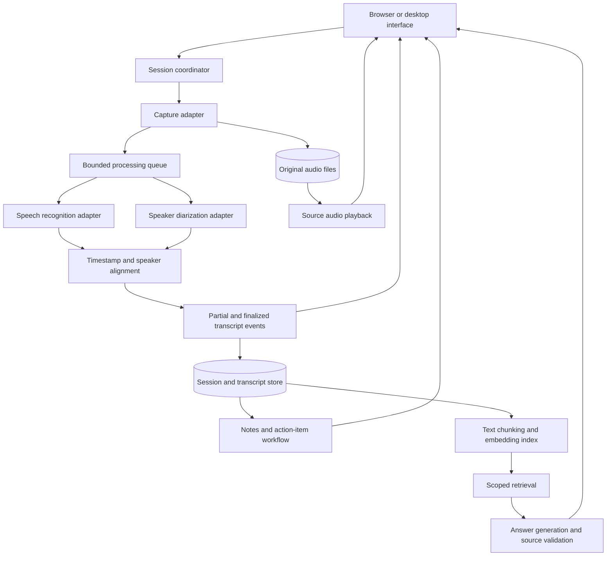
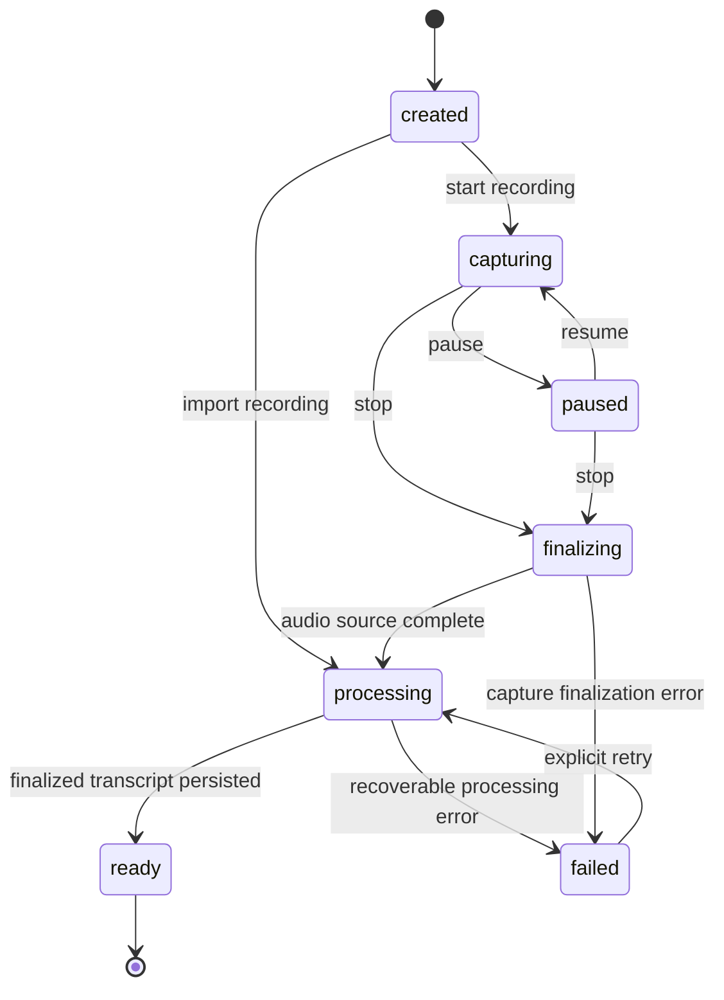

# System architecture

Status: proposed component architecture. The existing text-transcript prototype is described separately in [PROTOTYPE.md](PROTOTYPE.md). Component and technology choices remain subject to verification before implementation.

## Architectural approach

Use one application with clear module boundaries and a background processing worker. Avoid distributed services until measured scale or integration isolation requires them. Keep external speech/model providers behind adapters so capture, transcription, diarization, retrieval, and generation can be tested independently.

Audio frames used for speech processing and text chunks used for retrieval are different units. Their sizes, lifecycles, and performance requirements must be evaluated separately.

## Component map

## Responsibilities and boundaries

| Component | Input | Output | Boundary |
|---|---|---|---|
| Session coordinator | Session commands and adapter events | State changes and processing jobs | Owns lifecycle, cancellation, and recovery |
| Capture adapter | Recorded file, Windows inputs, or meeting integration | Audio frames and source metadata | Owns device/platform access; does not generate notes |
| Audio store | Audio data and session identity | Durable source reference | Preserves original material independently of ASR success |
| ASR adapter | Audio and language configuration | Text, timing, and partial/final status | Does not infer real participant identities |
| Diarization adapter | Audio on the same timeline | Speaker intervals | Produces anonymous IDs unless participant mapping is supplied |
| Alignment | Transcript timing and speaker intervals | Speaker-attributed segments | Preserves uncertainty, overlap, and corrections |
| Transcript store | Final segments and revisions | Queryable source material | Authoritative text source for notes and retrieval |
| Retrieval index | Finalized text and provenance | Searchable chunks and embeddings | Derived data; rebuildable when source/configuration changes |
| Notes workflow | Selected finalized transcript | Cited notes, decisions, and action items | Separate from question-driven retrieval |
| Q&A workflow | Question, scope, and retrieved passages | Cited answer or insufficient-information result | Cannot execute transcript instructions or external actions |

## Session lifecycle

Live draft text may appear during capture; it does not imply that the transcript is finalized or indexed. Recovery must distinguish a saved recording from failed transcription. A transcription failure must not discard the source audio.

## Data contracts

The initial contracts are conceptual and should be validated in the first component tests:

- **AudioFrame:** session ID, source ID, sequence number, sample format, monotonic time offset, and audio payload/reference.
- **TranscriptSegment:** stable segment ID, revision, start/end offsets, text, language, and partial/final status.
- **SpeakerInterval:** start/end offsets, stable anonymous speaker ID, and optional uncertainty information.
- **AttributedSegment:** transcript revision, speaker references, original source location, and correction provenance.
- **RetrievedPassage:** chunk ID, transcript revision, source location, text, retrieval method, and ranking signals.
- **GeneratedResult:** result type, cited claims, optional explicit action items, model/configuration identity, and processing metadata.

Partial events replace earlier revisions of the same segment. Finalized revisions are persisted idempotently. Corrections create a new revision and invalidate affected derived chunks; they must not silently change a previously cited source. Duplicate delivery is expected at adapter boundaries and must not create duplicate transcript entries.

## Timing and audio alignment

Use one monotonic session timeline for audio offsets and a separate UTC start timestamp for wall-clock display. Microphone and playback capture require synchronization and drift handling. ASR timing and speaker intervals must refer to the same audio timebase. Do not invent word-level timing when an engine provides only segment-level locations.

For mixed audio, diarization may produce Speaker 1/2 labels that require user naming. Participant-specific streams can provide stronger attribution, but one participant stream may contain several people. Preserve overlapping speech and uncertain mappings rather than forcing an unsupported identity.

## Persistence

Store session metadata, processing jobs, source references, transcript revisions, speaker labels, and generated-result provenance in a relational store. Store large audio objects as files/object references rather than database blobs by default. Keep embeddings as a rebuildable index keyed by transcript revision, embedding model, dimensions, and chunking configuration.

The local reference prototype uses SQLite and exact vector comparison. Retaining that storage or adopting a dedicated index depends on measured corpus size and concurrency, not on the presence of embeddings alone.

## Processing and efficiency

- Persist audio before treating a frame as safely received.
- Keep real-time capture independent of slow ASR, diarization, and model calls using bounded queues.
- Record queue lag and dropped/late frames; apply an explicit overload policy rather than unbounded buffering.
- Reuse compatible model sessions and cached embeddings; avoid re-embedding unchanged text.
- Index finalized text rather than every provisional token.
- Generate notes at explicit checkpoints or after finalization, rather than calling an LLM on every audio frame.
- Batch work where it reduces overhead without breaking the live latency requirement.
- Optimize measured bottlenecks. No hardware-specific latency, memory, availability, or scale guarantee is established yet.

## Failure handling and observability

Jobs should have explicit retryable/permanent error categories, bounded retries, cancellation, and resumable checkpoints. Capture loss, disk-full conditions, invalid model output, provider quota errors, inconsistent timestamps, and duplicate events need separate tests.

Measure capture gaps, queue lag, ASR latency, diarization latency, speaker errors, retrieval quality, generation latency, and provider usage. Logs must avoid raw private audio/transcript content and credentials by default.

## Privacy and authorization

Recording requires visible state, participant approval, and pause/stop controls. Document which processing is local and which sends content to external providers. Keep recordings and transcripts out of version control. Add retention and deletion behaviour alongside the persistence component.

The initial design is single-user and local. Authentication and retrieval-time user isolation are prerequisites for shared hosting. The meeting assistant does not receive authority from instructions spoken inside a recording.

## Evaluation gates

Evaluate each stage independently: parsing/provenance, ASR word accuracy, timing alignment, diarization/overlap, retrieval relevance, source-supported generation, action extraction, and insufficient-information behaviour. Keep labelled evaluation data separate from operational sources. Use representative audio and held-out questions before making quality claims.

## Open decisions

1. Supported Windows hardware and the initial audio formats.
2. ASR runtime/model and language behaviour, including mixed-language recordings.
3. Diarization runtime and alignment strategy.
4. Local capture mechanism and synchronization approach.
5. Google Meet integration and access/cost constraints.
6. Application shell, worker execution model, and persistence details after component spikes.

Record accepted decisions in `docs/decisions/`. A planned adapter is not an implemented integration.
